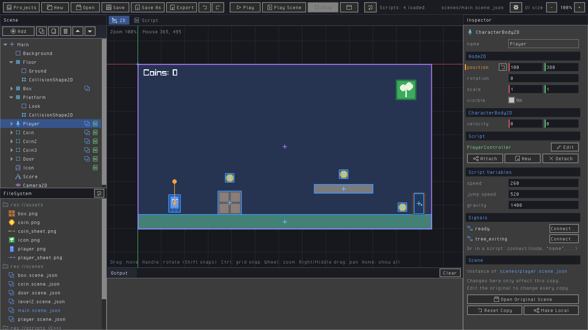

<p align="center">
  
</p>

<h1 align="center">Sprout</h1>

<p align="center">
  <b>A friendly C++ editor and engine for making your very first 2D games.</b><br>
  <a href="https://sproutengine.dev">Website</a> ·
  <a href="#quick-start">Quick start</a> ·
  <a href="#documentation">Documentation</a> ·
  <a href="#engine-examples">Examples</a> ·
  <a href="CONTRIBUTING.md">Contributing</a>
</p>

<p align="center">
  
</p>

Place nodes with the mouse like in [Godot](https://godotengine.org), write C++
scripts that reload while the game runs, and export to Windows, macOS, Linux
and the web with one button. Or skip the editor and write your whole game as
code with the engine. Free and MIT licensed, built on
[raylib](https://www.raylib.com).

## Quick start

You need a C++ compiler, **CMake 3.25 or newer** and **Git**. Don't have them?
The [installation guide](docs/01-installing.md) walks you through it for
Windows, macOS and Linux.

**Windows** (in the Developer PowerShell for VS):

```bat
git clone https://github.com/MrJkl561/Cpp-Game-engine-.git
cd Cpp-Game-engine-
scripts\run-editor.bat
```

**macOS / Linux:**

```bash
git clone https://github.com/MrJkl561/Cpp-Game-engine-.git
cd Cpp-Game-engine-
scripts/run-editor.sh
```

The first build downloads raylib and friends, so it takes a few minutes. The
editor opens with a demo platformer: press **Play** (F5) to try it. Then
follow **[Your first game in the editor](docs/editor/getting-started.md)**
(about 15 minutes), or **[Your first game](docs/02-your-first-game.md)** if
you'd rather use the code-only engine.

<details>
<summary><b>Building by hand, and running the engine examples</b></summary>

```bash
cmake -S . -B build
cmake --build build
```

| | Windows | macOS / Linux |
|---|---|---|
| **Engine:** your first game | `build\bin\my_first_game\my_first_game.exe` | `./build/bin/my_first_game/my_first_game` |
| **Engine:** an example | `build\bin\04_pong\04_pong.exe` | `./build/bin/04_pong/04_pong` |
| **Editor** | `build\bin\sprout_editor\sprout_editor.exe` | `./build/bin/sprout_editor/sprout_editor` |

Prefer Visual Studio, VS Code or CLion? See
[Building from a code editor](docs/01-installing.md#building-from-a-code-editor).

</details>

## Documentation

Everything is written for beginners. Every guide is one click away from here.

### The Editor

| Guide | What you'll learn |
|---|---|
| [Your first game in the editor](docs/editor/getting-started.md) | A character that runs and jumps, step by step |
| [Signals, step by step](docs/editor/signals.md) | Making one part of your game react to another |
| [Multiplayer](docs/editor/multiplayer.md) | Playing together over a network |
| [The Editor manual](editor/README.md) | Everything below, in one place |

Jump straight to a part of the manual:
[Projects](editor/README.md#projects) ·
[Using the editor](editor/README.md#using-it) ·
[Nodes](editor/README.md#nodes) ·
[C++ scripts](editor/README.md#c-scripts) ·
[The Script tab](editor/README.md#editing-scripts-the-script-tab) ·
[VS Code / Visual Studio](editor/README.md#using-another-code-editor-vs-code-visual-studio) ·
[Inheritance](editor/README.md#sharing-code-between-scripts-inheritance) ·
[Script variables](editor/README.md#script-variables-shown-in-the-inspector) ·
[Signals](editor/README.md#signals) ·
[Hot reloading](editor/README.md#hot-reloading) ·
[Scenes inside scenes](editor/README.md#scenes-inside-scenes) ·
[Changing scenes](editor/README.md#changing-scenes-while-the-game-runs) ·
[Autoloads (global scripts)](editor/README.md#autoloads-global-scripts) ·
[Animation](editor/README.md#animation) ·
[Shaders](editor/README.md#shaders) ·
[Multiplayer](editor/README.md#multiplayer) ·
[Exporting your game](editor/README.md#exporting-your-game) ·
[Portable editor](editor/README.md#moving-the-editor-or-a-portable-copy) ·
[Themes](editor/README.md#customizing-the-editor) ·
[Project files](editor/README.md#files)

### The Engine

Start at the top and work your way down:

| # | Guide | |
|---|---|---|
| 1 | [Installing and building](docs/01-installing.md) | Compiler, CMake and Git (the same for the editor) |
| 2 | [Your first game](docs/02-your-first-game.md) | "Catch the Falling Stars", from an empty file |
| 3 | [How a game works](docs/03-how-a-game-works.md) | Frames, `dt` and coordinates |
| 4 | [Scenes](docs/04-scenes.md) | Title screens, levels, game over |
| 5 | [Entities](docs/05-entities.md) | Players, enemies, coins; spawning and collisions |
| 6 | [Input](docs/06-input.md) | Keyboard, mouse and gamepads |
| 7 | [Drawing](docs/07-drawing.md) | Shapes, text, pictures and sprites |
| 8 | [Sound and music](docs/08-sound-and-music.md) | Sound effects and music |
| 9 | [Levels and physics](docs/09-levels-and-physics.md) | Tile maps, gravity and jumping |
| 10 | [Camera and effects](docs/10-camera-and-effects.md) | Following, zoom, shake and particles |
| 11 | [Timers](docs/11-timers.md) | Doing things later, or every few seconds |
| 12 | [Menus and UI](docs/12-menus-and-ui.md) | Buttons, sliders and themes |
| 13 | [Saving](docs/13-saving.md) | High scores, settings and JSON |
| 14 | [Math and random numbers](docs/14-math-and-random.md) | `Vec2`, `lerp`, angles and randomness |

### Help

- **[Cheat sheet](docs/cheat-sheet.md)**: keep it open while you code (engine)
- **[Troubleshooting](docs/troubleshooting.md)**: when something goes wrong
- **[Using Sprout in your own project](docs/using-sprout-in-your-own-project.md)**: your game in its own repository
- **[The documentation index](docs/README.md)**
- **[Contributing](CONTRIBUTING.md)**: how Sprout is organised, the tests and the house style
- Found a bug or have a question? [Open an issue](https://github.com/MrJkl561/Cpp-Game-engine-/issues)

## Engine or Editor?

Sprout comes in **two parts**. Pick whichever suits the way you like to work:

| | **Sprout Engine** | **Sprout Editor** |
|---|---|---|
| **What it is** | A code-only game library | A visual editor, like a small [Godot](https://godotengine.org) |
| **How you make a game** | Write one C++ file, build it, play | Place nodes in a scene with the mouse, attach C++ scripts, press Play |
| **Where it lives** | [`engine/`](engine/) (namespace `sprout::`) | [`editor/`](editor/) (namespace `s2d::`) |
| **Your games live in** | `games/<name>/main.cpp` in this repository | Project folders anywhere (`~/SproutProjects/<name>/` by default) |
| **Good for** | Learning how games work from the ground up; games that are mostly code | Levels you want to *see* and drag around; tweaking values without recompiling |
| **Change code while it runs** | No, rebuild and restart | Yes, scripts hot reload while the game runs |
| **Runs on** | Windows, macOS, Linux (build it on each one) | Windows, macOS, Linux; it **exports** games for Windows (x64 and ARM64), Linux, macOS and the **web** with an Export button |
| **Multiplayer** | No | Yes: host/join, synced nodes, RPCs, prediction, dedicated servers |
| **Events** | Check things in `update()` | Godot-style **signals**, connected in the Inspector or in code |
| **Start here** | [Your first game](docs/02-your-first-game.md) | [Your first game in the editor](docs/editor/getting-started.md) |

**They're separate.** The editor is *not* a front end for the engine: it has
its own small node system, modelled on Godot's, and a game made with one can't
be opened by the other. They share a repository, a build and a love of
beginners, not code.

- **Choose the Engine** if you're learning to program games, like having
  everything in front of you as code, or are following a C++ course. There's
  less to learn: a game is a class with `update()` and `draw()`.
- **Choose the Editor** if you think visually, already know Godot (or Unity),
  want to build levels by dragging things around, or want a web build to put
  on itch.io.
- **Not sure?** Start with the engine tutorial. Everything you learn there
  (frames, `dt`, velocity, collisions) carries straight over to the editor.

<details>
<summary><b>A taste of the Engine</b>: a complete game in one file</summary>

Move the circle with the arrow keys, and press Space for fireworks.

```cpp
#include <sprout/sprout.hpp>

using namespace sprout;

struct Hello : Scene {
    Vec2 player{400, 225};

    void update(float dt) override {
        player += getVector("left", "right", "up", "down") * 300 * dt;
        if (isKeyPressed(Key::Space)) particles.burst(player, randomColor(), 40);
    }

    void draw() override {
        drawCircle(player, 30, Color::Gold);
    }

    void drawUI() override {
        drawText("Arrow keys to move, Space for fireworks", 10, 10, 20);
    }
};

int main() {
    Game game("Hello, Sprout!", 800, 450);
    game.run<Hello>();
}
```

</details>

<details>
<summary><b>A taste of the Editor</b>: a script that makes a character run and jump</summary>

You build the scene with the mouse (a `CharacterBody2D` with a `Sprite2D` and
a `CollisionShape2D` inside), then attach this script. The three `EXPORT`
values show up in the Inspector so you can tune them without touching the code:

```cpp
#include "script.hpp"

using namespace s2d;

class Hero : public Script {
public:
    EXPORT(float, speed, 250);
    EXPORT(float, jumpSpeed, 500);
    EXPORT(float, gravity, 1200);

    void process(float delta) override {
        auto* body = self<CharacterBody2D>();
        if (!body) return;

        body->velocity.x = 0;
        if (IsKeyDown(KEY_LEFT)) body->velocity.x = -speed;
        if (IsKeyDown(KEY_RIGHT)) body->velocity.x = speed;

        body->velocity.y += gravity * delta;
        if (body->isOnFloor() && IsKeyPressed(KEY_SPACE)) body->velocity.y = -jumpSpeed;

        body->moveAndSlide();
    }
};

REGISTER_SCRIPT(Hero)
```

</details>

## Making games with the Editor

Open the editor (`scripts/run-editor.sh` or `scripts\run-editor.bat`) and
press **Projects** → **New Project...**. Each project is a folder of its own,
anywhere you like, and the editor never needs rebuilding for a new one:

```
My Game/
├── project.json    <- name, main scene, window size, autoloads, export settings
├── scenes/         <- your scenes (*.scene.json)
├── assets/         <- pictures
├── scripts/        <- your C++ scripts
└── exports/        <- finished games, made by Export
```

<details>
<summary><b>What the Editor gives you</b></summary>

- **Godot-style nodes**: `Node2D`, `Sprite2D`, `AnimatedSprite2D`, `ColorRect`,
  `Label`, `Camera2D`, `StaticBody2D`, `CharacterBody2D` (with
  `moveAndSlide()`), `Area2D`, `CollisionShape2D` and `Timer`.
- **A live viewport**: drag, rotate, snap, zoom and pan; drop pictures in
  from your desktop.
- **C++ scripts on nodes** with `ready()` and `process(delta)`, which **hot
  reload** while the game runs.
- **Signals** like Godot's: connect them in the Inspector (the editor writes
  the function for you) or in code with `connect(getNode("Area2D"),
  "body_entered", &Coin::onBody)`; your own with `SIGNAL(died)` and
  `emitSignal("died")`; and a `Timer` node.
- **`EXPORT(float, speed, 250);`** puts a script variable in the Inspector, so
  every node can have its own value.
- **A built-in script editor** with autocomplete, and **errors as you type**
  from [clangd](https://clangd.llvm.org/) (downloaded for you; nothing to
  install). Or open scripts in VS Code, Visual Studio, CLion...
- **Scenes inside scenes** (build the player once, use it in every level),
  and changing scenes while the game runs.
- **Sprite sheet animation** with named animations.
- **Export** to Windows (x64 and ARM64), Linux, macOS (universal) and the
  **web**, with one button.
- **Multiplayer** like Godot's: host or join a game, `MultiplayerSynchronizer`
  and `MultiplayerSpawner` nodes, `RPC`s, **Run Instances** to test several
  copies at once, and dedicated servers (`--server`). Other players move
  smoothly (interpolation), your own moves at once while the server stays in
  charge (client-side prediction), and shots hit what you saw (lag
  compensation). Start from the
  **Multiplayer** project template.
- **Several projects**, a Project Manager, undo/redo, and editable themes and
  panel sizes.

</details>

## Making games with the Engine

Each engine game is a folder in `games/` with a `main.cpp`.

1. Copy the folder `games/my_first_game` and give the copy a new name, like
   `games/space_cats`.
2. Build again (`scripts/build.sh` or `scripts\build.bat`). Sprout finds the
   new folder automatically.
3. Run `build/bin/space_cats/space_cats` (`build\bin\space_cats\space_cats.exe`
   on Windows), and start changing `main.cpp`!

Put pictures and sounds in an `assets` folder next to your `main.cpp`. It's
copied next to your game every time you build, so
`loadTexture("assets/cat.png")` just works.

<details>
<summary><b>What the Engine gives you</b></summary>

- **Scenes** for each screen of your game (title, levels, game over), with
  `start`, `update`, `draw` and `drawUI`, and `changeScene<GameOver>(score)` to
  switch between them.
- **Entities** for the things in your game: `spawn<Enemy>(position)`,
  `findAll<Coin>()`, `findClosest<Enemy>(point)`, `destroy()` and easy collision
  checks.
- **Input actions** that work with keyboard, mouse and gamepads at once:
  `getVector("left", "right", "up", "down")`, `isActionPressed("jump")`.
- **Drawing** shapes, text, custom fonts, pictures, and **sprites** with sprite
  sheet animation, flipping and tinting.
- **Levels made of letters** with `TileMap`, and **`moveAndSlide`** physics for
  walls, floors, gravity and jumping.
- **Camera** that follows, zooms, stays inside the level and shakes.
- **Particles** for explosions, sparks, flames and confetti.
- **Sound effects and music** in one line: `playSound("assets/jump.wav")`.
- **Timers and cooldowns**: `every(2.0f, [this] { spawn<Enemy>(); })`,
  `Cooldown gun{0.25f}`.
- **Menus**: buttons, sliders, checkboxes, text boxes and themes.
- **Save files** for high scores and settings, and **JSON** for your own level
  and enemy data.
- `Vec2`, `Rect`, `clamp`, `lerp`, `moveToward`, angles in degrees, and easy
  **random numbers**.
- **Friendly messages** instead of crashes when a file is missing or something
  goes wrong.

**What the Engine isn't:** it's for 2D desktop games written in code. There's
no 3D, no networking, and no web or mobile export (the Editor can export to the
web). If you outgrow it, you can call
[raylib-cpp](https://github.com/RobLoach/raylib-cpp) directly from a Sprout
game, see
[Using raylib-cpp](docs/using-sprout-in-your-own-project.md#going-further-using-raylib-cpp-directly).

</details>

### Engine examples

Every example is a complete game with lots of comments. Read them in order:

| Example | What it shows |
|---|---|
| [`01_hello_world`](examples/01_hello_world/main.cpp) | The smallest possible game: a window with some text |
| [`02_shapes_and_colors`](examples/02_shapes_and_colors/main.cpp) | Drawing shapes, text and your own colors |
| [`03_moving_around`](examples/03_moving_around/main.cpp) | Moving with the keyboard, `dt`, `clamp` |
| [`04_pong`](examples/04_pong/main.cpp) | Two-player Pong: your own input actions, bouncing |
| [`05_coin_collector`](examples/05_coin_collector/main.cpp) | Entities, spawning, collisions and a saved high score |
| [`06_space_shooter`](examples/06_space_shooter/main.cpp) | Ships, bullets and asteroids, explosions and screen shake |
| [`07_platformer`](examples/07_platformer/main.cpp) | Tile maps, gravity, jumping and a following camera |
| [`08_snake`](examples/08_snake/main.cpp) | A grid-based game with a growing list |
| [`09_menus_and_settings`](examples/09_menus_and_settings/main.cpp) | Title menu, settings screen and saved settings |
| [`10_sprites_and_sound`](examples/10_sprites_and_sound/main.cpp) | Pictures, animations, sound effects and music |

## Build scripts

The [`scripts/`](scripts/) folder has ready-made scripts for each kind of build
(`.bat` for Windows, `.sh` for macOS and Linux). Run them from the repository
folder:

| What | Windows | macOS / Linux |
|---|---|---|
| Build everything | `scripts\build.bat` | `scripts/build.sh` |
| A Debug build | `scripts\build.bat debug` | `scripts/build.sh debug` |
| Build and open the editor | `scripts\run-editor.bat` | `scripts/run-editor.sh` |
| A [portable editor](editor/README.md#moving-the-editor-or-a-portable-copy) (one folder to put anywhere) | `scripts\make-portable.bat [folder]` | `scripts/make-portable.sh [folder]` |
| Run the unit tests | `scripts\test.bat` | `scripts/test.sh` |
| Test the editor's multiplayer | `scripts\test-multiplayer.bat` | `scripts/test-multiplayer.sh` |
| Test the editor's signals | `scripts\test-signals.bat` | `scripts/test-signals.sh` |
| Test the Script tab's checks | `scripts\test-lint.bat` | `scripts/test-lint.sh` |
| Test autoloads | `scripts\test-autoload.bat` | `scripts/test-autoload.sh` |
| Test shaders | `scripts\test-shaders.bat` | `scripts/test-shaders.sh` |
| Export a game | `scripts\export.bat windows,web [project] [folder]` | `scripts/export.sh linux,web [project] [folder]` |
| Set up web exports (once) | `scripts\setup-web.bat [emsdk folder]` | `scripts/setup-web.sh [emsdk folder]` |

They build into `build-x64\` or `build-arm64\` on Windows (for this PC's own CPU;
add `x64` or `arm64` to choose) and `build-release/` or `build-debug/` on
macOS and Linux, so the programs are in `<that folder>/bin/...` instead of
`build/bin/...`.

**ARM64:** Sprout builds and runs on ARM64 as well as x86-64: Windows on ARM,
ARM64 Linux (e.g. a Raspberry Pi 5) and Apple Silicon Macs. The editor's
Windows export makes an x64 `.exe` that runs on every Windows PC, and there's a
separate "Windows ARM64" export for native ARM64 games. Mac exports are
universal apps (Apple Silicon and Intel).

## Folder layout

<details>
<summary><b>What's in this repository</b></summary>

```
Cpp-Game-engine-/
├── engine/             <- THE ENGINE (code-only)
│   ├── include/sprout/ <- its headers (each starts with a how-to comment)
│   └── src/            <- its code
├── games/              <- your ENGINE games: one folder each, found automatically
│   └── my_first_game/
│       └── main.cpp
├── examples/           <- engine example games 01 to 10, to learn from
├── editor/             <- THE EDITOR (see editor/README.md)
│   ├── src/            <- the editor and its node system
│   ├── player/         <- the game runtime that exported games are built from
│   ├── templates/      <- New Project templates (Multiplayer)
│   ├── tests/          <- the editor's tests (multiplayer, signals)
│   └── project/        <- the editor's demo project
├── docs/               <- the documentation (docs/editor/ for the editor)
├── website/            <- the sproutengine.dev web page
├── scripts/            <- build, run-editor, make-portable, test, export, setup-web and the test-* scripts
├── tests/              <- the engine's unit tests
├── cmake/              <- build helpers (downloads libraries, sprout_add_game, ENet for the editor)
└── CMakeLists.txt      <- the main build file (you normally don't need to touch it)
```

Editor projects don't live in here: they're folders of their own, in
`SproutProjects` in your home folder unless you pick somewhere else.

After building, every engine game is in `build/bin/<game name>/`, next to a copy
of its `assets` folder, and the editor is `build/bin/sprout_editor/sprout_editor`.

</details>

## Built with

Sprout stands on the shoulders of these excellent open-source libraries. CMake
downloads them automatically; you don't need to install them.

| Library | Used for | License |
|---|---|---|
| [raylib](https://github.com/raysan5/raylib) 6.0 by Ramon Santamaria | Window, drawing, input, audio | zlib/libpng |
| [raylib-cpp](https://github.com/RobLoach/raylib-cpp) 6.0.3 by Rob Loach | The C++ wrapper for raylib that the engine and the editor are written with | zlib/libpng |
| [raygui](https://github.com/raysan5/raygui) 5.0 by Ramon Santamaria | The engine's in-game menus, and the editor's whole interface | zlib/libpng |
| [nlohmann/json](https://github.com/nlohmann/json) 3.12 by Niels Lohmann | Save files and JSON data; the editor's scenes, projects and network messages | MIT |
| [doctest](https://github.com/doctest/doctest) 2.4 | The engine's unit tests (only when tests are turned on) | MIT |
| [ENet](https://github.com/lsalzman/enet) 1.3 by Lee Salzman | The editor's multiplayer (UDP networking) | MIT |
| [clangd](https://clangd.llvm.org/) 21 (LLVM) | The editor's live script errors and colors (a ready-made download) | Apache 2.0 with LLVM exception |

Web exports from the editor also need [Emscripten](https://emscripten.org),
which the editor's Export window helps you set up.

Sprout's API is inspired by [Godot](https://godotengine.org),
[LÖVE](https://love2d.org), [Pygame Zero](https://pygame-zero.readthedocs.io)
and [raylib](https://www.raylib.com).

## License

Sprout itself is released under the **MIT License** (see [LICENSE](LICENSE)).
That means you can use it for anything, including games you sell, as long as you
keep the license notice. The libraries above have their own (similarly
permissive) licenses.
