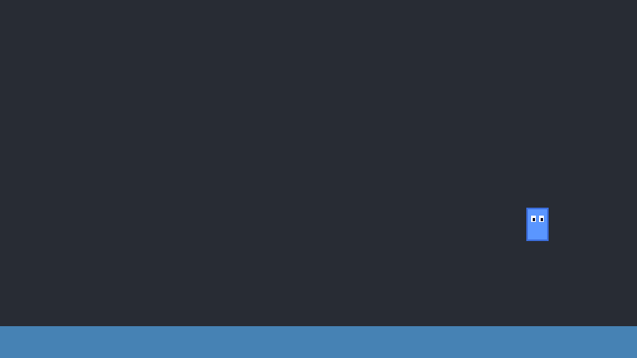

# Your first game in the Sprout Editor

In this tutorial you'll make **Jumpy**: a little character that runs left and
right and jumps on a floor. It takes about 15 minutes. Along the way you'll
learn the four things every editor game is made of: **projects, nodes,
scripts and Play**.



You'll need the editor built. If you haven't done that yet, see
[Quick start](../../README.md#quick-start) in the main README (the short version:
run `scripts\run-editor.bat` on Windows or `scripts/run-editor.sh` on macOS and
Linux).

> **Engine or editor?** This tutorial is for the **Sprout Editor**, the visual
> one with a scene tree and an inspector. If you'd rather write a whole game in
> code, follow the engine tutorial [Your first game](../02-your-first-game.md)
> instead. The two are separate: see
> [Engine or Editor?](../../README.md#engine-or-editor) for the difference.

---

## 1. Make a project

Every game is its own **project**: a folder with your scenes, pictures and
scripts in it.

1. Open the editor. (The first time, it opens a demo project: a small
   platformer. Press **Play** to try it, then **Stop**.)
2. Press **Projects** at the left of the toolbar.
3. Press **New Project...**, type the name `Jumpy` and press **Create**.

The editor makes a `Jumpy` folder in `SproutProjects` in your home folder
(press **Browse...** first to put it somewhere else) and opens it. You'll see:

| Where | What it is |
|---|---|
| **Scene** dock (top left) | The *node tree*: everything in the current scene. It starts with a `Main` node and a `Camera2D`. |
| **Viewport** (middle) | Your scene. The purple rectangle is the game window, 800 × 450 pixels. |
| **FileSystem** (bottom left) | The project's files: `assets/` (pictures), `scenes/` and `scripts/`. |
| **Inspector** (right) | The selected node's settings. |
| **Output** (bottom) | Messages, `print()` output and errors. |

> **Nodes** are the building blocks of a scene. Each node does one job: a
> `Sprite2D` draws a picture, a `ColorRect` draws a rectangle, a
> `CollisionShape2D` gives something a shape for physics. You build bigger
> things by putting nodes inside other nodes.

**Coordinates:** x goes right and y goes **down**, and (0, 0) is the top-left
corner of the game window. So (400, 225) is the middle of the window.

## 2. Make a floor

The floor needs to be solid, so it's a `StaticBody2D` (something that never
moves but that other things bump into). It gets two children: a `ColorRect` so
you can see it, and a `CollisionShape2D` so things can stand on it.

1. In the Scene dock, click **Main** to select it.
2. Press **Add** and pick **StaticBody2D**. It's added inside `Main`.
3. In the Inspector, change its **name** to `Floor` and its **position** to
   `400`, `430`. (Click a number to type it, or drag left/right on it.)
4. With `Floor` selected, press **Add** and pick **ColorRect**. Set its
   **position** to `-400`, `-20` and its **size** to `800`, `40`. Pick any
   **color** you like.
5. Select `Floor` again, press **Add** and pick **CollisionShape2D**. Set its
   **size** to `800`, `40`.

You now have a bar along the bottom of the game window.

> **Why -400, -20?** A child's position is measured from its parent. The
> `CollisionShape2D` is centered on the floor's position, but a `ColorRect`
> starts at its top-left corner, so we move it up and left by half its size.

## 3. Make the player

The player is a `CharacterBody2D`: a body that a script moves, which stops when
it hits floors and walls.

1. Select **Main**, press **Add** and pick **CharacterBody2D**. Name it
   `Player` and set its **position** to `400`, `200`.
2. With `Player` selected, press **Add** and pick **Sprite2D**. Then, in the
   FileSystem dock, open `assets/` and click **player.png**: the sprite now
   shows the picture. (Every new project comes with a few pictures to start
   with: `player.png`, `box.png`, `coin.png`...)
3. Select `Player` again, press **Add** and pick **CollisionShape2D**. Set its
   **size** to `32`, `48` (the size of the picture).

Your Scene dock should look like this:

```
Main
├── Camera2D
├── Floor           (StaticBody2D)
│   ├── ColorRect
│   └── CollisionShape2D
└── Player          (CharacterBody2D)
    ├── Sprite2D
    └── CollisionShape2D
```

Made a mistake? **Ctrl+Z** undoes it. You can also drag nodes around in the
Scene dock to move them into another parent.

Press **Ctrl+S** to save the scene.

## 4. Give the player a script

Nothing moves yet. Behaviour comes from **scripts**: small C++ classes attached
to nodes.

1. Select **Player**.
2. In the Inspector, under **Script**, press **New**, type `Hero` and press
   Enter.

The editor writes `scripts/hero.cpp`, attaches it to `Player`, and opens it in
the **Script** tab (the **2D | Script** switch above the viewport). Replace
everything in it with this:

```cpp
#include "script.hpp"

using namespace s2d;

class Hero : public Script {
public:
    // These show up in the Inspector, under Script Variables
    EXPORT(float, speed, 250);
    EXPORT(float, jumpSpeed, 500);
    EXPORT(float, gravity, 1200);

    void process(float delta) override {
        auto* body = self<CharacterBody2D>();  // the node this script is on
        if (!body) return;

        // Left and right
        body->velocity.x = 0;
        if (IsKeyDown(KEY_LEFT)) body->velocity.x = -speed;
        if (IsKeyDown(KEY_RIGHT)) body->velocity.x = speed;

        // Falling, and jumping when standing on something
        body->velocity.y += gravity * delta;
        if (body->isOnFloor() && IsKeyPressed(KEY_SPACE)) body->velocity.y = -jumpSpeed;

        body->moveAndSlide();  // move, and stop at floors and walls
    }
};

REGISTER_SCRIPT(Hero)
```

Press **Ctrl+S** to save it. The editor compiles it in the background; the
Output panel says when it's ready.

What it does, line by line:

- `class Hero : public Script` makes a script. `REGISTER_SCRIPT(Hero)` at the
  bottom tells the editor about it.
- `EXPORT(float, speed, 250);` makes a variable `speed` that starts at 250
  **and** shows it in the Inspector, so you can change it without touching the
  code.
- `process(delta)` runs every frame. `delta` is the time since the last frame
  in seconds (about 0.016), so `gravity * delta` is "how much faster we fall
  this frame".
- `self<CharacterBody2D>()` is the node this script is attached to.
- `velocity` is how fast the body moves, in pixels per second. Negative y is up.
- `moveAndSlide()` moves the body by its velocity and stops it at anything
  solid. Afterwards, `isOnFloor()` says whether it's standing on something.
- `IsKeyDown` (held) and `IsKeyPressed` (just pressed this frame) come from
  [raylib](https://www.raylib.com/cheatsheet/cheatsheet.html), which the editor
  is built on. You can use any raylib function in a script.

**Typos are caught as you type.** Mistakes get a red wavy underline with the
message at the end of the line, before you even save. Start typing
`body->` and a list of everything a `CharacterBody2D` has pops up; press
**Enter** to pick one.

## 5. Play!

Press **Play** (or **F5**). The arrow keys move, **Space** jumps. Press
**Stop** (**F8** or **Esc**) to go back to editing.

Now the fun part: with the game still running, go to the Script tab, change
`body->velocity.x = speed;` to `body->velocity.x = speed * 2;` and press
**Ctrl+S**. The game picks up the change straight away, without restarting.
That's **hot reloading**.

## 6. Tune it in the Inspector

Click **2D** to go back to the scene, select **Player**, and look in the
Inspector under **Script Variables**: there are `speed`, `jump_speed` and
`gravity`, from the `EXPORT` lines. Try a jump speed of 700 or a gravity of
600 and press Play again. Each node with this script can have its own values.

## 7. Make it reusable

In a real game the player goes into every level. Select **Player** and press
**Save Branch as Scene** in the Inspector. The player and its children are
saved to their own scene file, and the level now holds a copy of it. Drag that
scene file from the FileSystem into any other scene to put a player there.
Change the original, and every copy changes with it.

## 8. Share it

Press **Export** in the toolbar, tick the platforms you want (Windows, Linux,
macOS, Web) and press **Export**. You get a game in the project's `exports/`
folder that runs without the editor. Zip it up and send it to a friend. The
Export window tells you if a platform needs something installed first.

---

## What next?

Ideas to try with what you know:

- Add platforms: select `Floor`, press **Ctrl+D** to duplicate it, then make it
  smaller and move it up.
- Make the view follow the player: in the Scene dock, drag `Camera2D` onto
  `Player`, then set the camera's **position** to `0`, `0`.
- Add an `Area2D` coin that disappears when the player touches it
  (`getOverlappingBodies()`).
- Open the demo project (**Projects** → **Open Folder...** → the `editor/project`
  folder inside the Sprout folder) and read its scripts: coins, a moving box, a door to level 2, and an animated
  player.

Want to play it with friends? See **[Multiplayer in the editor](multiplayer.md)**,
or make a new project from the **Multiplayer** template.

Everything the editor can do is in the **[Sprout Editor manual](../../editor/README.md)**:

- [Using the editor](../../editor/README.md#using-it): every dock, shortcut and button
- [Nodes](../../editor/README.md#nodes): what each node type is for
- [C++ scripts](../../editor/README.md#c-scripts): the script API, `EXPORT`, hot reloading
- [Scenes inside scenes](../../editor/README.md#scenes-inside-scenes)
- [Changing scenes while the game runs](../../editor/README.md#changing-scenes-while-the-game-runs)
- [Animation](../../editor/README.md#animation)
- [Exporting your game](../../editor/README.md#exporting-your-game)
- [Customizing the editor](../../editor/README.md#customizing-the-editor): themes and layout
